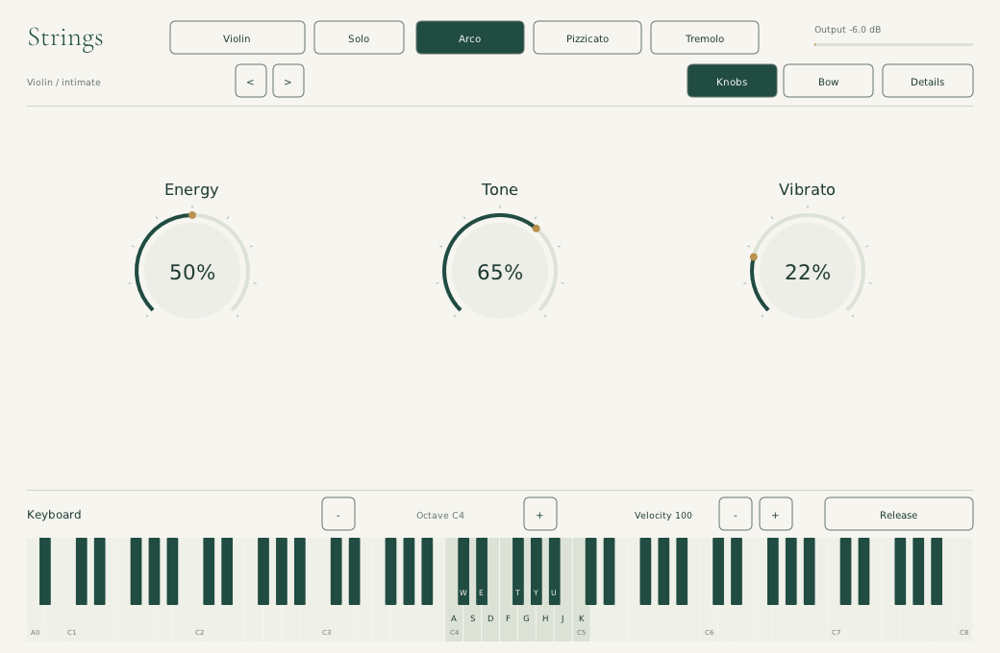

# Strings

**A playable, open-source physical-model string instrument.** Violin, viola,
cello and double bass, in solo or fixed-size divisi ensembles. VST3, CLAP and
standalone for Windows, macOS and Linux. MIT licensed; no sample downloads,
accounts, activation or network connection needed to play.

**Strings 0.3.2 — live instrument and 88-key keyboard.**
This experimental research/performance version includes the physical engine and
simplified native editor, unlike the earlier 0.1.0 scaffolding. See the
[research ledger](docs/research-implementation.md),
[five Astra UX studies](docs/ux-performance/index.html), and
[validation/run guide](docs/research-validation.md) for the current work.
For the universal Mac release and installation in REAPER, see
the [Mac testing guide](docs/mac-testing.md). The release archives include a
build identity file naming their exact source commit and workflow run.

The native [live instrument screen](docs/ux-components/live-instrument.md)
implements reusable NanoVG components: Energy/Tone/Vibrato knobs, a playable
88-key piano, optional bow gesture surface and progressively disclosed physical
controls. There is no embedded note editor, demo transport or instructional panel.
The [component plan and reference crops](docs/ux-components/component-plan.md)
separate the generated design from executable UI. Controller expression still
uses the documented external MIDI adapter; device-specific haptics are not implemented.

The [native component catalogue](docs/ux-components/catalog.md) identifies each
control and its test boundary. The earlier [standalone workflow trial](docs/ux-components/standalone-trial.md)
documents an externally recorded four-part cue. Its automation targets the prior
UI layout and needs updating before rerunning; it is not a native recording feature.



### Play standalone without a MIDI device

The current source adds a full **88-key piano (A0–C8)** below the editor: click/hold keys or
drag between them to play. Type `A W S E D F T G Y H U J K` for a chromatic octave
(the original violin `A S D F G H J K` white-note mapping remains). `Z`/`X` or the octave
buttons move the highlighted typing span, not the piano; velocity buttons
set the strength of subsequent notes. The typing span stays within the visible piano.
Held local notes highlight. Mouse release, leaving the key area, Escape, Release,
focus loss, octave/instrument changes and closing the UI release local notes.
Computer keys require editor focus; modifier shortcuts do not trigger notes.
These additions are included in 0.3.2; replace any previously downloaded 0.3.1 build.

The standalone is a live instrument: play the keyboard and shape the sound.
**Knobs**, **Bow** and **Details** switch control views; the piano stays visible.
The earlier note plot, demo playback, bow-take recorder and workflow-help panels
have been removed. Native standalone song recording/save/export remain unimplemented.

In a DAW, use the **host's** transport and MIDI recording/editor, automation and
bounce. Clicked/typed plugin keys audition the engine; there is **no MIDI output**
to record those events into host clips. Use the DAW's computer-MIDI keyboard or
external MIDI for recordable input. The host owns composition and recording.
See the [live instrument contract](docs/ux-components/live-instrument.md).

## Download and install

The 0.3.2 release provides `Strings-0.3.2-macos-universal.zip`,
`Strings-0.3.2-windows-x86_64.zip` and `Strings-0.3.2-linux-x86_64.zip`, plus
`SHA256SUMS.txt`. Archives include VST3, CLAP, standalone, documentation,
audio examples, validation logs and build identity. The older
[0.3.1 audit](docs/delivery-0.3.1.md) records a historical local delivery, not
validation of these new binaries or their removed composition prototype.

Get the archive for your operating system from
[GitHub Releases](https://github.com/kenotron-ms/strings-vst/releases/latest).
Extract it first. **Copy the entire `Strings.vst3` bundle**, not just a file
from inside it, to your VST3 folder. Rescan plugins in your DAW, add **Strings**
as an instrument on a MIDI track, and play your MIDI keyboard.

| System | VST3 folder | Build |
|---|---|---|
| Windows | `C:\Program Files\Common Files\VST3\` | x86-64 |
| macOS | `~/Library/Audio/Plug-Ins/VST3/` | Universal: Apple Silicon + Intel, macOS 11+ |
| Linux | `~/.vst3/` | x86-64, built on Ubuntu 22.04 |

CLAP: copy `Strings.clap` to `C:\Program Files\Common Files\CLAP\`,
`~/Library/Audio/Plug-Ins/CLAP/`, or `~/.clap/`, respectively.

macOS builds are ad-hoc signed, **not Apple-notarized**. If Gatekeeper blocks a
download you trust, inspect the source and use your system's security approval
flow. Advanced users can remove quarantine on this specific extracted bundle
with `xattr -dr com.apple.quarantine /path/to/Strings.vst3`. Windows builds are
also unsigned. Linux requires desktop OpenGL/X11 libraries and ALSA/PulseAudio
or JACK for standalone playback. A running JACK server is optional.

**Logic Pro does not load VST3 or CLAP.** An Audio Unit is not included.
Use a VST3/CLAP-capable host such as REAPER, Cubase, Bitwig or Ableton Live
(VST3). Individual host compatibility still needs broader user testing.

## Play

- Select **Violin**, **Viola**, **Cello**, or **Double bass**.
- **Solo** is last-note-priority monophonic, with legato transitions and return
  to a previously held note. **Ensemble** distributes a fixed 2–16 players
  across held notes. Three-note chords do not triple the section size.
- **Arco**, **Pizzicato**, and **Tremolo** change the excitation mechanism.
- Shape the sound with bow pressure, speed, contact point, brightness, vibrato,
  attack/release, player variation and room. Parameters are host-automatable.
- Twelve factory presets are available in the host and via the UI's arrows.
- Drag a control vertically; hold Shift for fine adjustment. Scroll to adjust;
  double-click to reset. `A S D F G H J K`
  plays a white-key octave when the UI has keyboard focus.
- MIDI: note on/off, velocity, pitch bend (±2 semitones), CC1 vibrato,
  CC11 expression, CC64 sustain, channel pressure, CC120 panic, CC123 all notes
  off, and CC121 controller reset. Channel controls affect notes on that channel.
- Projects save the instrument's parameter values through the plugin host.

## What is physically modeled?

The 0.2 research engine gives each player four strings with two transverse
waveguide lanes each. A nonlinear stick/slip bow junction excites the stopped
string. An implicit, passive two-direction modal bridge returns body motion
to all four strings, including sympathetic open strings. Loss and allpass
dispersion act inside the propagation paths. Signed bow motion, force, contact,
lift, rosin grip and body coupling change the simulation rather than simply
crossfading samples. Pizzicato uses a short force pulse; tremolo reverses the
bow. Independent players feed stereo placement and an optional shared room.

**This is still an experimental reduced model, not a measured acoustic digital
twin or demonstrated commercial competitor.** Body and string profiles are
synthetic, not measurement fits. Finite bow width, spatial heat flow, bow hairs,
torsion, fingerboard collisions and radiation directivity remain unimplemented.
Controls are normalized musical requests, not calibrated physical sensors.
No neural model is trained or used. Listen to the audition files and inspect
the research ledger before judging the timbre.

For optional direct mouse/touchpad playing, select **Mouse** or **Touch**,
hold a pitch and drag the bow panel: horizontal motion sets signed velocity,
vertical position sets force. Release or focus loss lifts the bow. Turn gesture
control off with **Follow controls** to restore its captured baseline. The browser studies add a standard
gamepad route through optional Web MIDI; see [input devices](docs/input-devices.md).

See [competitive research](docs/competitive-analysis.md),
[architecture](docs/architecture.md) and [release notes](docs/release-notes.md).

## Build

```sh
git clone --recursive https://github.com/kenotron-ms/strings-vst.git
cd strings-vst
cmake -S . -B build -DCMAKE_BUILD_TYPE=Release
cmake --build build --config Release --parallel
ctest --test-dir build -C Release --output-on-failure
```

On Debian/Ubuntu, install `build-essential cmake libgl1-mesa-dev libx11-dev
libxext-dev libxrandr-dev libxcursor-dev libasound2-dev libpulse-dev
libjack-jackd2-dev`. On Windows use Visual Studio 2022 C++; on macOS use Xcode
command line tools and CMake. Built plugins are in `build/bin/`.

The dependency-free engine and offline renderer also build without DPF:
`cmake -S . -B build-dsp -DSTRINGS_BUILD_PLUGIN=OFF`.
`strings_render output.wav [instrument:0-3] [players:1-16] [articulation:0-2]`
renders a short phrase. Add `sustain` to render a fixed note without vibrato.

For the research tests, `tests/host_smoke.py` and `tests/research_audio.py` use
NumPy and Pedalboard; `tests/ux_bridge_smoke.py` also uses Playwright/Chromium.
Reproduction commands and the distinction between synthetic input fixtures
and physically tested hardware are in [the run guide](docs/research-validation.md).

## Validation and releases

The GitHub Actions workflow builds all three platforms, runs engine tests,
renders five examples, validates each VST3 with pluginval at strictness 5, and
packages binaries with documentation/licenses. A separate sanitizer job checks
the DSP. Pushing a `v*` tag publishes a GitHub Release **only after every build
and test job succeeds**, with SHA-256 checksums. No commercial signing keys are
required or bundled. See [validation](docs/validation.md) for scope and limits.
