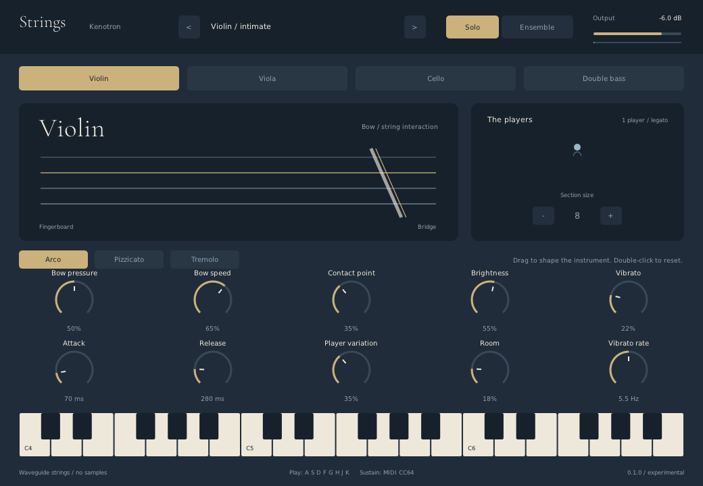

# Strings

**A playable, open-source physical-model string instrument.** Violin, viola,
cello and double bass, in solo or fixed-size divisi ensembles. VST3, CLAP and
standalone for Windows, macOS and Linux. MIT licensed; no sample downloads,
accounts, activation or network connection needed to play.



## Download and install

Get the archive for your operating system from
[GitHub Releases](https://github.com/kenotron-ms/strings-vst/releases/latest).
Extract it first. **Copy the entire `Strings.vst3` bundle**, not just a file
from inside it, to your VST3 folder. Rescan plugins in your DAW, add **Strings**
as an instrument on a MIDI track, and play your MIDI keyboard.

| System | VST3 folder | Build |
|---|---|---|
| Windows | `C:\Program Files\Common Files\VST3\` | x86-64 |
| macOS | `~/Library/Audio/Plug-Ins/VST3/` | Universal: Apple Silicon + Intel, macOS 11+ |
| Linux | `~/.vst3/` | x86-64, built on Ubuntu 22.04 |

CLAP: copy `Strings.clap` to `C:\Program Files\Common Files\CLAP\`,
`~/Library/Audio/Plug-Ins/CLAP/`, or `~/.clap/`, respectively.

macOS builds are ad-hoc signed, **not Apple-notarized**. If Gatekeeper blocks a
download you trust, inspect the source and use your system's security approval
flow. Advanced users can remove quarantine on this specific extracted bundle
with `xattr -dr com.apple.quarantine /path/to/Strings.vst3`. Windows builds are
also unsigned. Linux requires desktop OpenGL/X11 libraries and ALSA/PulseAudio
or JACK for standalone playback. A running JACK server is optional.

**Logic Pro does not load VST3 or CLAP.** An Audio Unit is not included in 0.1.0.
Use a VST3/CLAP-capable host such as REAPER, Cubase, Bitwig or Ableton Live
(VST3). Individual host compatibility still needs broader user testing.

## Play

- Select **Violin**, **Viola**, **Cello**, or **Double bass**.
- **Solo** is last-note-priority monophonic, with legato transitions and return
  to a previously held note. **Ensemble** distributes a fixed 2–16 players
  across held notes. Three-note chords do not triple the section size.
- **Arco**, **Pizzicato**, and **Tremolo** change the excitation mechanism.
- Shape the sound with bow pressure, speed, contact point, brightness, vibrato,
  attack/release, player variation and room. Parameters are host-automatable.
- Twelve factory presets are available in the host and via the UI's arrows.
- Drag a control vertically; hold Shift for fine adjustment. Scroll to adjust;
  double-click to reset. The on-screen keyboard plays notes. `A S D F G H J K`
  plays a white-key octave when the UI has keyboard focus.
- MIDI: note on/off, velocity, pitch bend (±2 semitones), CC1 vibrato,
  CC11 expression, CC64 sustain, channel pressure, CC120 panic, CC123 all notes
  off, and CC121 controller reset. Channel controls affect notes on that channel.
- Projects save the instrument's parameter values through the plugin host.

## What is physically modeled?

Two fractional-delay traveling-wave paths meet at a nonlinear bow-friction
junction. Frequency-dependent bridge loss, finger/nut reflection, bow speed,
pressure and contact point govern excitation and string vibration. A bank of
body resonators shapes radiation. Pizzicato injects a short noise excitation;
tremolo modulates the virtual bow. Ensemble players have independent waveguides,
body responses, detuning, vibrato phase/rate and positions. A shared room model
adds optional stereo ambience. No recorded instrument samples are used.

**0.1.0 is an experimental physical-model synthesizer, not a validated acoustic
digital twin or a replacement for SWAM/Soliste.** Body modes are hand-tuned,
not fitted to measurements. The model omits torsional and dual-polarization
motion, sympathetic open-string coupling, finite bow width, realistic bow
changes and measured radiation directivity. Controls are normalized musical
parameters, not calibrated newtons or meters/second. Listen to the included
audio examples before deciding whether its timbre suits your music.

See [competitive research](docs/competitive-analysis.md),
[architecture](docs/architecture.md) and [release notes](docs/release-notes.md).

## Build

```sh
git clone --recursive https://github.com/kenotron-ms/strings-vst.git
cd strings-vst
cmake -S . -B build -DCMAKE_BUILD_TYPE=Release
cmake --build build --config Release --parallel
ctest --test-dir build -C Release --output-on-failure
```

On Debian/Ubuntu, install `build-essential cmake libgl1-mesa-dev libx11-dev
libxext-dev libxrandr-dev libxcursor-dev libasound2-dev libpulse-dev
libjack-jackd2-dev`. On Windows use Visual Studio 2022 C++; on macOS use Xcode
command line tools and CMake. Built plugins are in `build/bin/`.

The dependency-free engine and offline renderer also build without DPF:
`cmake -S . -B build-dsp -DSTRINGS_BUILD_PLUGIN=OFF`.
`strings_render output.wav [instrument:0-3] [players:1-16] [articulation:0-2]`
renders a short phrase. Add `sustain` to render a fixed note without vibrato.

## Validation and releases

The GitHub Actions workflow builds all three platforms, runs engine tests,
renders five examples, validates each VST3 with pluginval at strictness 5, and
packages binaries with documentation/licenses. A separate sanitizer job checks
the DSP. Pushing a `v*` tag publishes a GitHub Release **only after every build
and test job succeeds**, with SHA-256 checksums. No commercial signing keys are
required or bundled. See [validation](docs/validation.md) for scope and limits.
