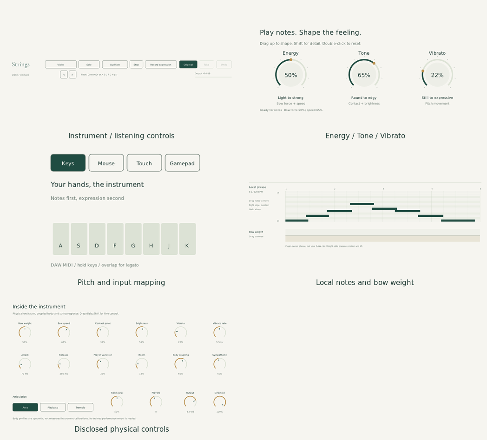

# Native component catalogue

November 8, 2026. This is an implementation inventory, not a catalogue of
image-model fragments. All visible controls below are NanoVG geometry/text.
The running synthesis is the research model in `docs/research-implementation.md`.

These are crops of the running editor, not newly generated image concepts.

| Component | Responsibility | Implementation | Verification / boundary |
| --- | --- | --- | --- |
| Instrument header | Four profiles, solo/ensemble, presets | `UI.cpp`, `Presets.hpp` | Native instrument selection; actual VST host covers all profiles. Presets are authored, not learned. |
| Listening transport | Audition, Stop, record local expression | `UI.cpp` | Eight-second UI-clock audition, not DAW transport or sample-accurate scheduling. |
| Energy knob | Pair force with speed | `PerformanceKnob.hpp`, `KeyboardPerformanceView`, `UI.cpp` | Bounded/fine drag tests and native captured audio/readback pixels. Existing physical host parameters, not an amplitude-only effect. |
| Tone knob | Pair contact with brightness | Same model/view/bridge | Native drag/screenshot and held-note host automation. An authored macro, not a measured timbre classifier. |
| Vibrato knob | Physical pitch modulation depth | Same model/view/bridge | Native drag and reset pixel checks; actual-host held-note test. |
| Knob editing lifecycle | Drag, Shift, scroll, reset, balanced host gestures | `UI.cpp` | Release, Escape, focus loss, preset and editor teardown close edits. No separate macro host parameters. |
| Pitch input | DAW MIDI or focused A–K keys | `Plugin.cpp`, `Engine.cpp`, `UI.cpp` | Actual-host MIDI tests; native key/audio tests. Computer-key register is limited; no chromatic keyboard or notation input. |
| Local piano roll | Move pitch/time, resize note, Undo | `PhraseEditor`, `PhraseRollLayout`, `PhraseRibbonView` | Headless bounds/ordering/hit tests and native selected-note pixels. Eight notes only; not the host clip. |
| Bow-weight lane | Revise a take without altering lift/motion | `ExpressionTake`, `PhraseRibbonView`, `UI.cpp` | Frame-edit/Undo tests and actual native capture. Tone/Vibrato lanes are not implemented. |
| Phrase backdrop | Make weight and progress readable | `PhraseRibbonView` | Low-opacity fill beneath the actual weight curve; no fake physics blob or background texture. |
| Take comparison | Original/Take/replay/one-step Undo | `ExpressionTake`, `UI.cpp` | Bounded capture, interpolation and gate-edge tests; captured replay audio. Editor-local, no persistent phrase state or export. |
| Optional gesture pad | Independent pitch plus signed motion/weight/lift | `ExpressionPad.hpp`, `ExpressionPadView.hpp` | Three-rate smoothing, native reversal/lift/readback, scaled hit regions and cancellation. Pointer position is not measured pressure. |
| Input map | Explain available routes without claiming connection | `InputMapView` | Keys, Mouse, Touch, Gamepad. No mouse illustration on the default Keys screen. |
| Controller adapter | Standard controller to native MIDI expression | `docs/ux-performance/midi.js` and adapter sources | Browser interaction/calibration/deadzone/disconnect tests plus actual VST MIDI render. No physical device test, adaptive triggers or raw DualSense touchpad. |
| Physical details drawer | Direct physical parameters and articulation | `UI.cpp` | Sixteen controls; host state/automation and pluginval. Synthetic body profiles, not measurement fits. |
| Safety/output strip | Release UI-owned notes, follow controls, output readout | `UI.cpp`, `Plugin.cpp` | Native release/focus tests, MIDI panic/release and finite bounded output. Not a remote DAW-wide panic. |
| Audio engine | Contact, strings, reciprocal body, ensemble allocation | `dsp/PhysicalModel.*`, `dsp/Engine.*` | Core/physics suites, actual VST host, numerical energy/contact checks. Explicit reduced-model limitations remain. |
| Standalone capture/export | Exercise real keyboard/knob workflow and save WAV | `tools/standalone_workflow.py` | External JACK recording of the real standalone executable. This is a reproducible trial tool, not a new native Record-to-WAV button. |

## Build order

1. Test bounded component state and geometry independently.
2. Render the components natively and connect real host parameters.
3. Build VST3, CLAP and the standalone sibling from the same engine/UI.
4. Test actual VST processing separately from standalone interaction/capture.
5. Capture screenshots at setup, note revision, expression revision, performance
   and final state. Retain raw audio alongside any mastered audition.

The standalone trial uses an original pirate-adventure cue, **Harbour Run**,
not the film theme. It lays down repeatable keyboard notes, compares unchanged
and shaped melody passes, then records violin, viola, cello and bass layers.
It exports MIDI for a DAW and WAVs from the actual standalone audio outputs.
An exact film-theme arrangement requires user-supplied musical material.
See [the standalone trial](standalone-trial.md) for commands, captures and the
distinction between local phrase editing and the longer scripted performance.

## Deliberately unfinished production features

Full MIDI-file import, arbitrary-length native phrase editing, persistent take
storage, host tempo synchronization, unrestricted undo, native WAV export,
trained performance generation, measured body calibration and physical
controller/haptic verification are not implied by this catalogue. The trial
must expose these boundaries rather than simulate a finished DAW inside a PNG.
