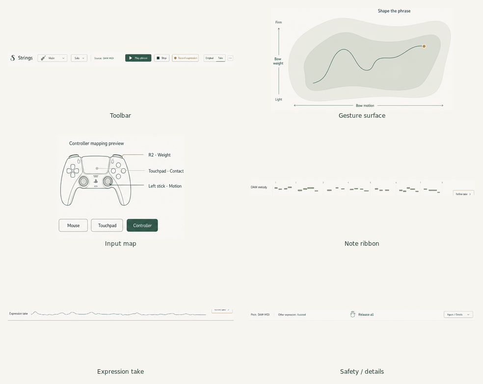

# Organic performance screen: component build plan

Reference: `../ux-production-storyboard/images/06-organic-performance.png`.
The images in `reference-crops/` are literal crops of that concept, not
screenshots of implemented functionality. No raster fragment is used as a UI
background. The native implementation uses NanoVG geometry and text.

Current executable implementation: [native-performance.md](native-performance.md).
`ExpressionPad.hpp` and `PerformanceSession.hpp` own renderer-independent state;
`ExpressionPadView.hpp` and `PerformanceViews.hpp` own the bespoke rendering;
`UI.cpp` connects host edits, transport ownership and cancellation. CTest can
exercise the two state components without a window or audio device.

## Visual contract

- Ivory `#F6F5F0`, pine `#204C42`, ink `#203B35`, sage `#DCE2D5`,
  brass `#BA914F`, muted `#66766D`.
- Cormorant Garamond for the instrument name; bundled DejaVu Sans for controls.
- The original image emphasized one large gesture surface. November 8 feedback
  supersedes that default with three front-panel knobs (Energy/Tone/Vibrato)
  and an editable piano roll. The direct gesture surface remains optional;
  a dense bank of physical controls stays behind Instrument details.
- Decorative contours were removed after user feedback: they did not encode
  physics or a musically meaningful region. Only the command dot, target ring
  and subtle fading command history remain on the optional gesture surface.
- Details are disclosed on request, with readable controls, not textures.

## Component contracts

| Reference crop | Native component | Responsibility and acceptance |
| --- | --- | --- |
| `toolbar.png` | Instrument/transport header | Four instrument profiles, solo/ensemble, local audition start/stop, output and preset selection; no imitation of the host transport. |
| `gesture-surface.png` | ExpressionPad model/view | Signed motion/weight, real smoothed readback and fading trail, separate input target, cancellation and scalable hit testing. |
| `input-map.png` | Input map | Explain physical mappings, choose mouse/touchpad or external MIDI adapter; never claim a device is connected just because its picture is shown. |
| `note-ribbon.png` | Local phrase editor | Editable eight-note pitch/time/duration preview and playhead, clearly not the DAW's MIDI editor. Fixed 120 BPM, no host-clip access. |
| `expression-take.png` | ExpressionTake model/view | Record one eight-second local command take, replay against the same audition, compare Original/Take and undo the last capture; no hidden pitch rewriting or learned interpretation. |
| `footer.png` | Safety/details strip | Release UI-owned notes/excitation, disclose physical controls, show pitch source and honest hardware status. |

The new `PerformanceKnob.hpp` isolates knob geometry and drag sensitivity for
headless tests. `KeyboardPerformanceView` renders three NanoVG dials; the UI
brackets their underlying host-parameter edits and closes them on cancellation.
The phrase lane's subdued fill encodes requested weight; no texture or filled
blob stands in for physical state. See [image brief](knob-phrase-image-brief.md)
for the next concept request, not an already-generated image.

## Scientific boundary

The seven-paper checklist remains in `../research-implementation.md`. Its
implemented reduced model is the sound source, not a replacement oscillator
behind a physics-themed screen. Finite-width thermal bow hair, measured body
calibration, neural fitting and acoustic radiation remain separate research
work, not functionality implied by the concept. Component tests and acoustic
listening evidence are different acceptance gates.
