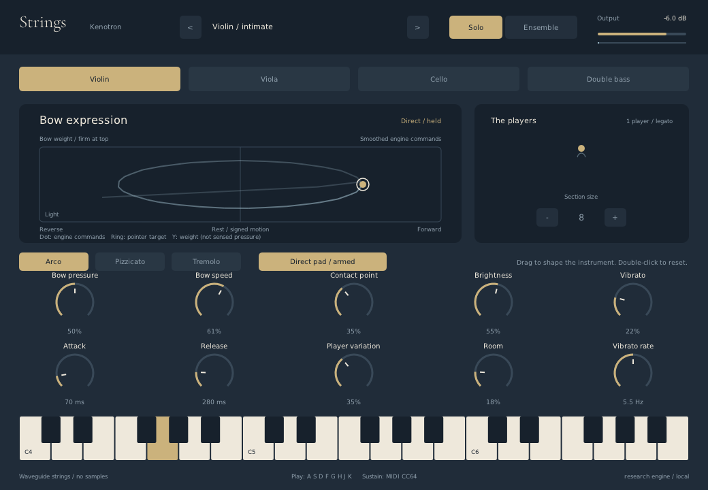

# Component 1: native bow-expression pad

**Historical first iteration.** The native 0.3 performance screen now composes
this model into the organic concept layout and adds local expression takes.
See [native-performance.md](native-performance.md) for current behavior. The
screenshots, layout coordinates and remaining-work list below describe 0.2.

November 8, 2026. This is executable native UI in the current local build, not
an image-model concept. It replaces only the old decorative string panel; the
existing instrument selectors, section view, dials and keyboard stay in place.
It is a first component iteration, not a claim of perfected ergonomics or sound.



This is an unretouched native screenshot from the synthetic-input audio probe,
not an image-model rendering. The trail follows engine command readback.

## What to audition

Build and run `build/bin/Strings`, or load the newly built VST3 bundle in a host.
Use a conservative output level and select Arco for the bowing experiment.

1. In **Follow controls**, play MIDI or use `A S D F G H J K` while this editor
   has focus. The dot reflects smoothed global bow commands from the engine.
   Existing dials, host automation and MIDI CC16/17/19/20 can move it.
2. Click **Enable direct pad**. This snapshots the prior four bow parameters,
   lifts the bow and waits for a deliberate press. Pitch still comes separately
   from MIDI or the computer keys.
3. Hold inside the pad: X selects signed bow-speed command; left reverses,
   center rests, right moves forward. Y assigns weight; top is firm, bottom is
   light. A small center deadzone makes rest easy to find.
4. Unlike the earlier relative mouse-bow gesture, **a stationary held pointer
   maintains the selected command**, like holding an analog stick off center.
   This is an assigned position-to-command mapping, not measured hand pressure
   or a simulation of the pointer's physical travel distance.
5. Release, leave the pad, lose window focus or press Escape to end the direct
   gesture. Speed and bow engagement go to zero; direct mode stays armed and
   requires a new press. Escape/focus loss also release UI-owned pitch notes,
   not arbitrary notes owned by the DAW.
6. Click the direct-mode button again to return to **Follow controls** and
   restore the snapshot, rather than forcing hard-coded bow defaults. Closing
   an armed editor also returns those prior controls; a host may continue its
   own held notes. Loading a host preset cancels the UI gesture without writing
   the old gesture values over the newly loaded preset.

## Read the control

- **Filled dot:** smoothed global motion/weight commands reported by the DSP.
  It is bright while a voice and bow engagement are active, muted otherwise.
- **Hollow ring:** current pointer target, shown only while dragging. It can
  lead the dot while engine parameter smoothing catches up.
- **Trail:** at most 2.5 seconds of actual sampled command readback while
  voices/bow are engaged, at no more than 30 samples/second. It fades and expires
  while idle. It is not a recorded take, waveform or decorative animation.
- **Waiting for engine readback:** no invented dot until all three monitor
  parameters have arrived. This is not a fake connected-device indicator.

The dot is deliberately labeled **Smoothed engine commands**. It is not
measured string displacement, Newtons, actual contact force, calibrated bow
velocity or a per-player diagnostic. Velocity, channel expression/pressure,
player variation, envelopes, tremolo and nonlinear friction act downstream.
Pizzicato does not become bow-controlled merely because these values are shown.

## Component boundary

| Piece | Source | Responsibility |
| --- | --- | --- |
| Model and layout | `src/ui/ExpressionPad.hpp` | Bounded normalized input, target/readback separation, fixed-capacity history, hit mapping; no renderer or engine dependency. |
| NanoVG view | `src/ui/ExpressionPadView.hpp` | Flat paths, circles, lines, text and clipping; no images, textures, new rendering stack or audio work. |
| Native integration | `src/UI.cpp` | Mouse ownership, mode snapshot/restore, four host edit gestures, keyboard/focus cancellation, engine readback and existing UI scale. |
| DSP monitors | `src/Parameters.hpp`, `src/dsp/Engine.cpp` | Three appended read-only outputs: signed `BowSpeed * BowDirection`, `BowPressure`, `BowEngaged`, all from the engine's smoothed global values. |

Existing parameter IDs remain unchanged; monitor IDs are appended after Rosin.
Monitors are not automatable inputs and reject writes. UI changes use the
existing four input parameters, with one host begin/end edit pair per gesture.
No sound-model equations or controller mappings were replaced in this step.

## Verification

```sh
cmake --build build -j 4
ctest --test-dir build --output-on-failure
python tests/native_expression_pad_smoke.py
python tests/host_smoke.py build/bin/Strings.vst3
```

The optional native probe uses NumPy, Xvfb, xdotool, ImageMagick, libX11, JACK
dummy audio and jack_rec, like the existing native gesture probe. Its owned
processes are shut down in `finally`. The report, WAV and native screenshots go
to `build/expression-pad-validation/`, separately from the earlier archive's
research evidence.

The C++ `expression_pad` test checks geometry, deadzone, invalid/bounded values,
target/readback separation, fixed-capacity/expiring history, cancellation and
three-rate smoothed telemetry including MIDI and read-only output enforcement.
The native probe checks stationary sustained sound, reversal, actual engine-dot
pixel positions, secondary-button safety, a real-input trail, Escape release,
restored controls, resized hit testing and focus-loss release through captured
audio. These are synthetic input/audio checks, not human comfort or realism
assessment. See the actual report for measured values and pass/fail status.

The local November 8 verification passes all three Release CTest suites, all
three ASan/UBSan suites, the twelve instrument/sample-rate VST3 render cases,
the native audio/UI probe and pluginval strictness 5, including editor tests.
Pedalboard/pluginval emit DPF lifecycle warnings; they are retained in the logs,
not presented as a warning-free run. The standalone Steinberg validator was
not supplied to pluginval and was skipped. This does not establish compatibility
with every DAW. Build-specific hashes and report paths are recorded in
`build/expression-pad-validation/manifest.json`.

## Still separate work

Record/replay/undo, phrase interpretation, learned assistance, a native gamepad
adapter and advanced haptics are not delivered by this component. Standard
controller traces can still reach the engine through the documented browser
MIDI adapter; physical controllers and live OS routing remain unverified.
Different inputs do not yet have a global arbitration/locking layer: host
automation and concurrent CC writers can compete, and the engine readback
shows the resulting commands rather than claiming a source is exclusive.

Prior research archives/reports describe their earlier binary snapshot. The
current build has new monitor parameters and a new module hash; do not reuse
the earlier archive's hash or pluginval report as proof for this iteration.
