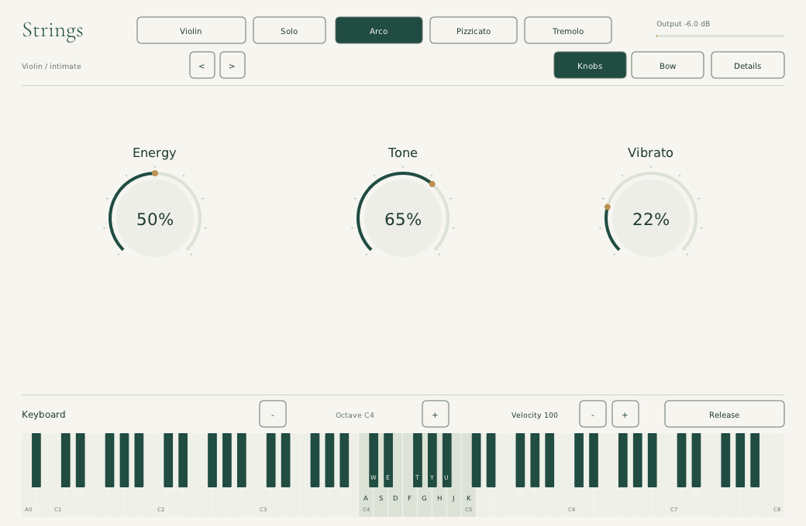

# Live instrument screen

Current direction: **an instrument, not a second DAW**. No note plot, embedded
song timeline, demo transport, capture/take toolbar or on-screen instruction blocks.

## Composition of the screen

- Header: instrument, Solo/Ensemble, Arco/Pizzicato/Tremolo, preset selection and output meter.
- Knobs: Energy, Tone and Vibrato, spread across the available width.
- Bow: an optional two-axis gesture surface, with only functional axis/state labels.
- Details: physical parameters, disclosed on request rather than explained in the main view.
- Piano: all 88 keys A0–C8, taller white/black keys, highlighted typing span, octave, velocity and Release.

The piano remains available in every view. Click/hold or drag to play; focused
computer keys also work, so one hand can hold pitches while the mouse shapes a
knob. The keyboard releases its notes on focus loss, Escape, register/instrument
changes or explicit Release. Hidden note/timeline editing has been removed.

The existing paper/pine/sage/brass palette and serif wordmark are preserved.
Hierarchy comes from larger controls, a deeper piano and whitespace—not extra
cards, illustrations, instructional prose or decorative physics plots.

## Standalone and hosted behavior

Standalone is for playing the instrument directly without MIDI hardware. There
is no native song recorder or export button. In a DAW, use host-routed MIDI,
automation and the host transport/recorder. Plugin-clicked/typed notes audition
internally; they are not MIDI output to record into host clips.

The earlier [storyboard](workflow-storyboard.md) and [separate critique](journey-critique.md)
remain historical context, not current UI requirements. This revision deliberately
removes their attempt to embed a composing workflow inside the instrument.

## Evidence

The screenshot is the actual Linux standalone, not an image-generated mockup.
Core CTest suites, `tests/native_keyboard_smoke.py` and
`tests/native_expression_pad_smoke.py` cover model bounds, live keyboard sound,
release safety, knob changes, optional bow control and minimum-size input.
The old plot's area is probed to ensure it no longer edits/plays anything.
Mac interaction and named-DAW workflows still need separate verification.
