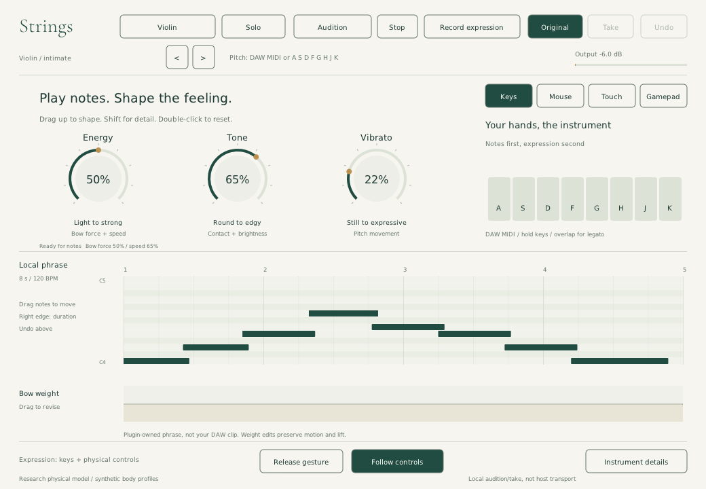

# Native performance screen — local 0.3.1

November 8 feedback revision: the filled organic contours are removed because
they did not represent physical state or a calibrated musical region. The
remaining subtle moving trail shows recent engine commands, not string motion.
The default is now keyboard-first: three expressive knobs above a local piano
roll and editable bow-weight lane. See [input research](input-research.md) for
the Ableton note/expression reference and the distinction between the delivered
open-loop controls and a future assisted performer.

This is the native NanoVG implementation of the selected organic image concept,
not the earlier HTML study or a raster UI background. Reference crops and
component contracts are in [component-plan.md](component-plan.md).



This screenshot is the running plugin, not an image-model render. The new
image-generation brief is [knob-phrase-image-brief.md](knob-phrase-image-brief.md);
API fallback permission for that new image brief is still pending. The current
0.3.1 archives and per-outcome audit are identified in
[delivery-0.3.1.md](../delivery-0.3.1.md). Historical 0.3.0 packages do not
contain these controls. Nothing new has been publicly released.

## Compose and audition

1. Load the whole locally built `build/bin/Strings.vst3` bundle in a DAW.
   Alternatively run `build/bin/Strings` with JACK for standalone auditioning.
2. Click the instrument name to cycle violin, viola, cello and double bass.
   Toggle Solo/Ensemble. Choose an authored starting preset using the arrows.
3. Supply your melody through normal DAW MIDI. With editor focus, computer
   keys `A S D F G H J K` also play a diatonic octave in the selected register.
4. In **Keys**, drag Energy, Tone or Vibrato vertically. Shift gives fine
   adjustment; scrolling changes a value; double-click resets the affected
   underlying parameters to their factory defaults. Energy sets bow force and
   speed; Tone sets contact and brightness; Vibrato sets the existing physical
   pitch modulation. These are authored open-loop mappings, not trained bow
   planning. Host automation retains the underlying physical parameters.
5. **Mouse/Touch** optionally opens the direct expression pad. A held X position
   sets signed motion and Y sets weight; center rests. Release or leave to lift.
   Follow controls restores the bow snapshot taken before a direct gesture.
   Pointer Y is assigned weight, not sensed pressure. Dot/trail show smoothed
   command history and the ring shows the input target, not acoustic motion.
6. Open Instrument details for contact, brightness, vibrato, attack/release,
   rosin, reciprocal body coupling, sympathetic strings, player variation,
   section size, output and direction. The front panel keeps only three knobs.

The DAW remains the composition timeline. **Local phrase** is a plugin-owned
eight-note, eight-second preview at a fixed 120 BPM, not the host's MIDI clip.
Drag notes to change pitch/time; drag their right edge to resize duration.
The last note edit has swap Undo. Audition plays this edited phrase on MIDI
channel 16. Overlaps choose the most recently started active note. A subtle
fill below the weight curve represents actual requested weight, not simulated
vibration. No notation transcription, arbitrary MIDI import, adding/deleting
notes, tempo synchronization or full arrangement editing is implemented.
Avoid running local preview over live DAW MIDI unless intentionally combining
both sources in the instrument allocator.

## Record and compare a local expression take

- **Record expression** starts the local preview and captures its four bow
  command requests (motion, weight, engagement through existing parameters).
  Turn Energy or perform a direct-pad gesture while the notes play. Release
  events from the direct pad are captured. Tone and Vibrato are not stored in
  this four-parameter scratch take; record their automation in the DAW.
- Recording ends after eight seconds, on Stop, Escape, focus loss or Finish
  recording. No browser, cloud service or trained model is involved.
- Choose **Take**, then **Audition** to replay the captured controls against the
  same local notes. Choose **Original**, then **Audition** for the current
  baseline controls. Audition does not automatically start on a comparison
  button press. Grabbing a front-panel knob or the surface overrides take replay.
- **Undo** restores the prior local capture when playback is stopped. Takes
  have fixed storage, bounded values and a maximum eight-second time range.
  Motion/weight interpolate; engagement edges remain discrete.
- Drag the bow-weight lane to revise the closest existing take frame. An empty
  lane starts a constant 33-frame curve. Editing weight preserves motion and
  lift rather than silently lowering a previously lifted bow. Undo restores
  the previous take; it is not an unlimited multi-action history.
- These scratch takes live in the editor, not host preset state. Closing the
  editor loses them. There is no native take export, arbitrary MIDI clip import,
  beat-synchronized host transport or multitrack take
  arrangement here. For an actual composition, record normal DAW automation or
  MIDI control data. UI audition timing depends on editor idle delivery and is
  not sample-accurate; a long editor stall cancels playback instead of catching
  up a backlog of notes.

The three monitor outputs are read-only smoothed *global commands*. They are
not sensed force, string displacement, per-voice contact diagnostics or proof
of an acoustically realistic performance. The scratch take captures UI command
requests, not every incoming MIDI event or the final physical state. Therefore
Controller mode directs recording to the DAW, rather than pretending it can
capture an external controller stream from potentially cached UI parameters.

## Controller route and safety

Controller displays the mapping for the existing browser-to-MIDI adapter:
left stick motion, RT/R2 weight, LT/L2 engagement, right stick contact/vibrato.
Follow [input-devices.md](../input-devices.md) to connect and arm that adapter
through a dedicated MIDI route. The controller drawing is not a connected
device indicator. Native USB/Bluetooth discovery, adaptive triggers, haptics
and raw DualSense touchpad events are not implemented. Mouse and ordinary
touchpad are the same native pointer route, with no fabricated pressure.

Stop/Escape/focus loss cancel local playback and active gestures and release
UI-owned notes. Changing preset cancels brackets without overwriting the new
preset with old gesture values. Closing an editor restores its captured bow
baseline. None of these promises an all-channel host panic: use the DAW's panic
for notes owned by another source. Concurrent CC or automation writers are not
globally locked out. Record automation deliberately: audition/replay writes
the same real host parameters that control the instrument.

## Research in the running engine

The synthesis path is `Engine -> Voice -> PhysicalInstrument -> StringLane /
BowContact / PassiveBody`, not an unrelated oscillator under this screen.
The research-to-code and omission matrix remains in
[research-implementation.md](../research-implementation.md).

This iteration removes sample-rate-dependent time constants in global bow
control smoothing, legato pitch settling and string delay retuning. Their
one-pole blends now use `1-exp(-dt/tau)` in seconds: 13 ms, 3.36 ms and
0.823 ms respectively. Those are documented engineering choices, not paper
constants or learned musician behavior. A three-rate test compares the actual
13-ms monitor response and exact target settling. The global smoother snaps
when a float update stagnates or comes within one millionth of its parameter
range; this avoids retaining history-dependent near-target commands. This is
an engineering precision rule, not a paper equation. New contact tests evaluate the nonlinear
friction equation's residual, static slip and junction relation across force,
compliance, direction and sample rate, in addition to the existing passivity,
dissipation, sympathetic transfer and allocation-free rendering checks.

This remains a reduced research instrument. Synthetic body/string profiles,
high-register bow-dependent intonation, missing measured radiativity and
unvalidated perceptual realism prevent a professional-parity claim. Finite bow
width, distributed thermal friction/hair, fingerboard collisions, learned
performance generation and neural fitting have not silently become implemented.

## Reproduce validation

```sh
cmake -S . -B build -DCMAKE_BUILD_TYPE=Release
cmake --build build -j4
ctest --test-dir build --output-on-failure
python tests/host_smoke.py build/bin/Strings.vst3
python tests/host_automation_smoke.py build/bin/Strings.vst3
python tests/research_audio.py
python tests/native_expression_pad_smoke.py
python tests/ux_bridge_smoke.py
python tests/ux_interaction_smoke.py
```

Python probes need the dependencies described in the research run guide. The
host automation probe compares sustained-note audio before and after host
parameter updates, without note retriggering, across four instruments at three
rates. It checks force, contact, reversal, lift and vibrato, release and state
recall. Its updates occur at render-call boundaries, not sample-accurate DAW
automation curves. Pluginval separately exercises sub-block automation.

The native probe additionally uses Xvfb, xdotool, ImageMagick and JACK dummy audio.
It captures actual audio during held/reversed gestures, local recording and
take replay; checks DSP-dot pixels; verifies cancellation and scaled hit tests;
and saves native screenshots. It does not stand in for a musician listening
study, a physical controller or live audio-device deadline testing.

`build/performance-validation/ctest.log` and `knobs-native.log` track the current
checks. The stronger `host-automation` probe now passes 60 held-note comparisons
and state recall. Its initial repeated-prefix failure was isolated to test
setup: reset/reinstantiation could restore processor state over queued baseline
changes. The test now resets/activates first, then applies and settles baseline
parameters without another reset. Identical prefixes are still required; the
comparison tolerance was not relaxed. Failed experiments remain in the logs.
The refreshed `manifest.json` fingerprints current source, binaries, reports
and clean standalone captures. `package-check.json` separately verifies the
resulting 0.3.1 archives; packaging rejects stale version/source/binary hashes.
This is a local research-prototype delivery, not acoustic certification or a
new public release.
