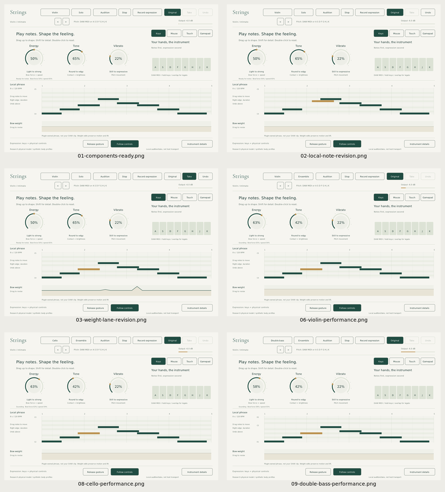

# Standalone composition trial: Harbour Run

**Historical layout:** the editor is now a [live instrument](live-instrument.md).
This trial and its captures document the earlier layout. Its script's UI
coordinates need updating before rerunning; the note plot, local transport
and bow-take controls no longer exist.

The requested trial is to use the instrument, not merely render an attractive
interface or call an unrelated synthesizer. **Harbour Run is an original
pirate-adventure cue, not the Pirates of the Caribbean theme or an arrangement
of its melody.** The exact requested theme needs user-supplied musical material.

## What this trial actually does

1. Build the native plugin components and the standalone sibling from the same
   engine/UI. Separately test the VST3 in an actual host.
2. Open the real standalone under Xvfb, with its own JACK dummy server, without
   altering the user's existing audio server or opening network listeners.
3. Capture the default component layout, an actual local note edit, an actual
   weight-lane edit, and ensemble setup. Undo the local edits before performing.
4. Lay out a repeatable original 16-bar, 6/8 melody at quarter-note 126 BPM.
   Export a four-track MIDI file and the explicit note schedule.
5. Play the melody through the editor's actual computer-key note input. Record
   the baseline, then repeat the same notes while dragging Energy/Tone/Vibrato.
6. Record viola harmony, cello pulses and bass roots through their real profile
   selectors. Each track is captured from the standalone's JACK audio outputs.
7. Mix the four shaped stems with fixed gains and a constant master gain.
   Retain the untouched raw baseline/stems for comparison. No sampled strings,
   replacement synth, pitch correction or hidden post-synthesis timbre layer.
8. Capture each instrument during performance and the final stopped state.

This is synthetic X11 operation of the real application. It is not a physical
controller test or a claim that an agent has listened like a human musician.
Numerical audibility, clipping and release checks cannot establish realism.

## Reproduce

Dependencies: the normal native build, Python/NumPy, JACK (`jackd`, `jack_lsp`,
`jack_rec`), Xvfb, xdotool and ImageMagick `import`.

```sh
cmake -S . -B build -DCMAKE_BUILD_TYPE=Release
cmake --build build -j4
ctest --test-dir build --output-on-failure
python tests/standalone_workflow_tests.py
python tools/standalone_workflow.py --plan-only
python tools/standalone_workflow.py
python tests/standalone_audio_audit.py build/standalone-workflow
```

Default output: `build/standalone-workflow/`. Choose a different `--output`
directory for a new completed session; the tool refuses to overwrite a prior
successful `session.json`. All temporary processes are terminated on exit.
The default JACK period is 2048 frames and the trial sets four players per
section, explicitly visible in its details screenshot. This is a non-realtime
capture configuration, not a low-latency performance claim. `--period` selects
1024, 2048 or 4096 frames for an environment-specific trial.

Outputs after a successful run:

- `session.json`: exact standalone hash, actual capture checks, event lateness,
  screenshots, mix gain and explicit limitations.
- `harbour-run-strings.wav`: the four-part audition, stereo 48 kHz / 16-bit.
- `violin-baseline-raw.wav`, `violin-raw.wav`, `viola-raw.wav`, `cello-raw.wav`,
  `double-bass-raw.wav`: real captures, including recorder lead-in and tail.
- `harbour-run.mid`, `score.json`: original authored notes, not extracted from
  the film soundtrack or a generated notation image.
- `screenshots/01-components-ready.png` through the final numbered view:
  native setup, revision and in-performance evidence.
- Separate JACK, application and per-take recorder logs.

## First attempt and correction

The initial eight-player/1024-frame run in `build/standalone-workflow/` produced
audible, bounded files but logged 476 JACK processing-error lines. Its initial
limited file checks missed that problem. Its retained `session.json` is now
marked **failed**; that master must not be presented as a clean capture.

The corrected trial additionally rejects JACK deadline errors for each capture,
uses four-player sections and a 2048-frame period, and takes in-performance
screenshots asynchronously so screenshot overhead does not stall note input.
It runs in `build/standalone-workflow-r2/`. The separate audio audit checks the
whole JACK log, pre-note silence, releases, master clipping and long baseline
melody notes. Completed-session results belong in that folder, not in the old
0.3.0 package manifest.

## Completed retry — November 8, 2026

The corrected run and independent `standalone_audio_audit.py` both passed.
Five 26-second raw stereo captures contain the 22.857-second original score
plus recorder lead-in and release. The complete JACK log contains **zero
processing-error lines**. Maximum scheduled UI-event lateness was 52.8 ms
(viola); this is not sample-accurate performance. All takes end in silence.
The four-stem master peaks at 0.79996, with a constant +8.652 dB master gain.
No dynamics processing or replacement sound source was used.

The baseline melody audit accepted 14 of 16 long-note windows at its normalized
autocorrelation threshold; accepted estimates were within 10.27 cents of their
expected pitches. Two low-confidence windows were excluded, not declared in
tune. This is a narrow diagnostic, not a score transcription or realism test.
The shaped violin differs measurably in signal energy from the baseline, but
wall-clock timing differences mean the RMS difference does not isolate timbre.

Local listening files: `build/standalone-workflow-r2/harbour-run-strings.wav`
and the five `*-raw.wav` files. The binary package includes them under
`Standalone trial/`, together with MIDI, score, session and audio-audit reports.
The preserved first failed run is not packaged as a clean listening example.



Full-size captures are in `screenshots/standalone-trial/`. These show the real
native editor, not image-model renders. The local piano roll during the longer
performance remains the separate eight-second audition described below.

## What trying the workflow exposes

The current native phrase editor owns only its eight-second, eight-note
audition. It cannot import this 23-second MIDI file or show it as the DAW's
clip. During the longer trial its visible **Local phrase** remains that separate
audition, not a fake visualization of the performed melody. The longer score
is supplied through the same keyboard route a person can play, then exported
for a DAW. That is repeatable, but still an awkward composition boundary.

The scratch expression take records four bow commands, not Tone/Vibrato.
For a real project, put the melody in a DAW and record the underlying parameter
automation. This trial schedules knob moves again rather than claiming a full
native multi-lane performance recorder already exists.

UI events and recorder starts use wall-clock timing. Measured lateness includes
screenshot/interaction overhead; layers are not sample-accurately aligned like
host tracks. The standalone executable is not itself a VST3 host; it shares the
VST3's synthesis/UI source. Actual VST3 processing is covered separately by the
host and pluginval probes. JACK dummy capture is not a live audio-device test.

The next production components suggested by this trial are an explicit
arbitrary-length phrase import/source selector, persistent multi-lane expression
storage, sample-timed scheduling, and a clear distinction between audition and
the actual composition. Measured body calibration and musician listening are
still needed before treating the sound as a convincing acoustic replacement.
