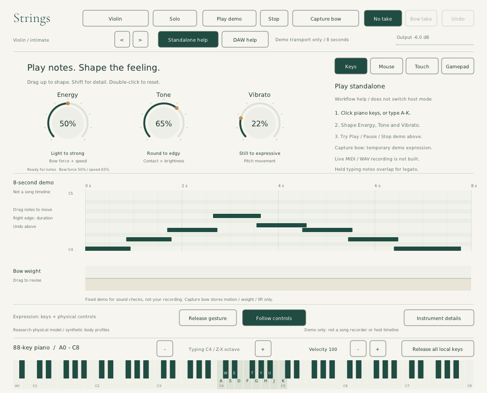
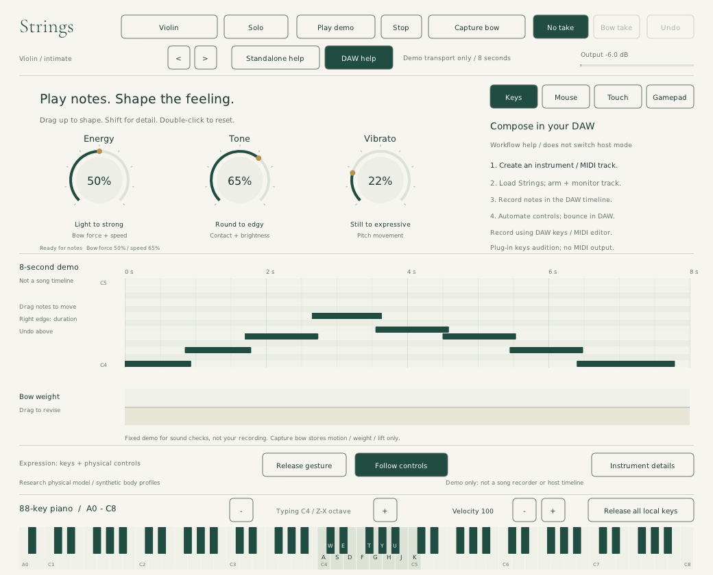
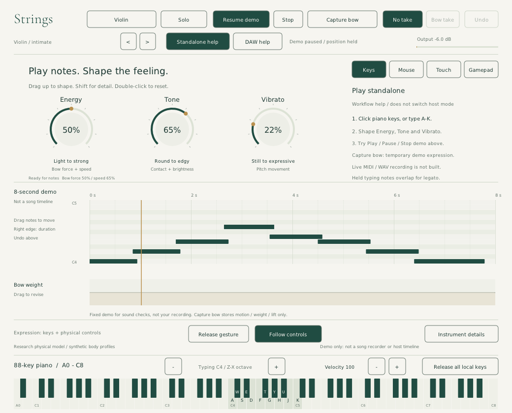

# Strings: standalone and DAW workflow storyboard

**Superseded design study:** the subsequent user direction is a live instrument,
not an embedded composer. The note plot, demo/take controls and workflow-help
panels described here have been removed from the native editor. See the
[current live instrument](live-instrument.md); retain this document as historical
journey analysis, not a description of current screens or a committed feature plan.

November 8, 2026. Design and implementation boundary for the native NanoVG editor.

## Revised native screens

These are captures of the running Linux standalone, not image-generated concepts.
DAW help is shown in standalone here; this is not a screenshot from a tested DAW.

## Who we are designing for

A composer/sound designer who knows harmony, piano-roll editing and DAWs, but
does not play violin. They want to sketch pitches, hear convincing phrasing,
perform expression in a second pass, revise a passage and keep the result.
They should not need to learn bow physics to get a useful first sound.

The central sequence is **choose sound → play notes → shape a phrase → listen
and revise → keep the result**. Pitch input and expression input are separate
jobs. A mouse cannot hold a piano key and turn a knob simultaneously: computer
keys, host MIDI or a repeatable phrase provide pitches during expression edits.

## First: what is actually delivered

The current standalone is a live instrument and sound-check workspace, **not a
complete standalone composer**. It has an 88-key A0–C8 piano, focused computer
typing, live knobs, an editable fixed eight-second demo and temporary bow takes.
It cannot record a new melody into a native clip, save/reopen those clips/takes
or export them. The external JACK workflow script is not a native recorder.

The DAW is the composer/recorder when the plugin is hosted. Plugin UI piano and
typing events inject directly into its engine; they do **not** provide MIDI
output to host clips. The user must use host-routed input or the host MIDI editor
for recordable notes. No DAW compatibility test is implied by this storyboard.

## Journey A: standalone, no MIDI hardware

| Frame | User's intent and action | Visible response / screen | Delivered or gap |
| --- | --- | --- | --- |
| A1 · Find a sound | Launch, choose Violin/Solo and a preset. | Performance screen: instrument, Energy/Tone/Vibrato, full piano, Standalone help. | Delivered. Audio-device setup is platform/backend dependent; a guided device picker is a future screen. |
| A2 · Play the idea | Click the piano or type A W S E D F T G Y H U J K. Use Z/X for the highlighted typing span; set velocity. | Only the held local keys light up. Full A0–C8 piano remains fixed. Typing-span changes do not transpose the demo. | Delivered. Mouse plays one pointer note; computer-key overlap supports legato. The piano is not an acoustic-range guarantee. |
| A3 · Shape the sound | Hold overlapping computer notes and drag Energy, Tone or Vibrato. | Knob values change the audible model. Instrument details reveal physical parameters only when needed. | Delivered for live sound, not recorded automation. Hardware expression remains optional; no native controller haptics claim. |
| A4 · Hear a repeatable phrase | Choose Play demo; Pause demo; Resume demo; Stop. Edit demo note position/duration when stopped. | Eight-second ruler, moving/held playhead, explicit changing button label; Stop returns to zero. | Delivered. This is a sound check, not the just-played melody. |
| A5 · Try a bow pass | Choose Capture bow, perform supported bow gestures/weight changes, then Finish bow take. Select Bow take and Play demo. | Same demo notes with captured motion, weight and lift. No take bypasses that expression on the next preview. | Delivered, temporary and editor-local. Energy's bow parameters can participate, but Tone/Vibrato and new notes are not captured as a complete performance. |
| A6 · Keep the composition | Record my own melody; retake expression; save a project; export WAV/MIDI. | Target: clip recorder, take chooser, save/export dialog and confirmation of saved location. | **Missing. This is the blocking standalone composition gap.** Do not imply that Capture bow completes this step. |

Current safe endpoint: play live or compare temporary demo expression. The
journey does not yet end in a saved composition.

## Journey B: inside a DAW

| Frame | User's intent and action | Screen / ownership | Delivered or gap |
| --- | --- | --- | --- |
| B1 · Set up the instrument | Add Strings to an instrument/MIDI track; choose input, arm and monitor. | DAW track owns input routing. Plugin DAW help explains this; choosing help does not switch a runtime mode. | Host workflow; verify in the specific DAW. |
| B2 · Sketch pitches | Use the DAW MIDI editor, DAW computer-MIDI keyboard or external MIDI keyboard. | DAW clip/piano roll owns note positions, duration and song length. Plugin keys remain an audition convenience. | Host MIDI drives the engine. UI audition is not a portable way to record host MIDI clips. |
| B3 · Record the melody | Press Record/Play/Pause/Stop in the DAW, not the plugin's demo controls. | Host transport, count-in, tempo and timeline remain authoritative. | Host owned. Plugin demo does not follow host tempo or position. No global Space shortcut is stolen by this change. |
| B4 · Perform expression | Loop a passage in the host; automate Energy/Tone/Vibrato or physical controls. | DAW automation lanes store the expression pass; plugin reflects parameters. | Parameters are automatable. Host automation and local bow replay can contend: avoid running a local take during the host pass. Recording paired Energy/Tone gestures needs host-specific automation verification. |
| B5 · Refine the phrase | Edit DAW notes/automation, audition at bar 12 or beyond; adjust instrument details if needed. | Host editor remains the only song editor. The plugin's eight-second panel does not display or edit host clips. | Host owned. Plugin-host clip mirroring is not implemented or required for the core workflow. |
| B6 · Keep the result | Save the DAW project and bounce/freeze/export audio. | Host save/export dialogs and saved-file confirmation. | Plugin parameters are host state; local demo edits/bow takes are not durable project data. Actual save/reopen/bounce must be checked in a named host. |

## Keyboard contract

- Full standard 88-key layout: 52 white keys and 36 black keys, A0–C8, with C
  octave labels. Scientific pitch labels use MIDI 60 = C4; a host may label it differently.
- The sage typing span is a 13-note overlay, **not** the instrument's entire range.
  Z/X shifts only that overlay, within the piano; MIDI and clicked pitches are unchanged.
- Keyboard register does not move demo notes. Held-note ownership is separate
  for typing, pointer and demo; Release all local keys releases pointer/typing,
  while Stop stops the demo. Escape/focus loss are broader safety releases.
- At the minimum 832-pixel width the black keys are narrow. The current native
  test proves targeting works at selected points, not that precision is comfortable.
  A magnified keyboard viewport is a candidate usability improvement, not delivered.
- Physical-instrument range, sounding pitch and playable synthetic piano range
  must not be confused. Future range shading should inform, not silently transpose.

## Transport and capture contract

| Control/state | Current operation | Explicit non-operation |
| --- | --- | --- |
| Play demo, stopped | Starts the eight-second reference phrase at zero. | Does not play a saved user song or the host transport. |
| Pause demo, running | Holds demo position and capture clock; releases demo and held local keyboard notes. | Does not pause the audio device or the DAW. Release tails may decay. |
| Resume demo, paused | Continues from held demo position, including a bow capture in progress. | Does not restart or consume wall-clock pause time. |
| Stop | Ends demo/capture, releases the demo note and rewinds demo position. | Not a global DAW panic; it does not stop host-input notes. |
| Capture bow | Starts/replaces an editor-local bow take over the reference phrase. | Not live MIDI, WAV, new-note or all-knob recording; not persistent. |
| Finish bow take | Ends the temporary bow capture. | Does not save a project or export a file. |
| No take / Bow take | Chooses expression source for the next demo preview. | No take is not an immutable snapshot of original sound parameters. |

## The four-bar issue

The earlier four numbered bars represented a hard-coded **eight-second demo**,
not four bars from a longer composition. There is currently no song-length
model, tempo-synced arrangement, scrolling viewport or add-note recorder behind
it. Changing the labels to sixteen bars would not implement any of those.

The revised native ruler therefore says **0s, 2s, 4s, 6s, 8s**, “8-second demo”
and “Not a song timeline.” This removes the false promise rather than hiding
the capacity limit. In a DAW, the host timeline determines track length.

For the target standalone composer, total length and visible range must be
separate: a 16-bar phrase might show bars 9–12 while playback continues across
viewport edges. Provide horizontal scroll/zoom, a full-phrase overview, a visible
loop range and bar/beat ruler with tempo. Four visible bars must never truncate
recording or playback. This is proposed work, not current functionality.

## Target screen architecture and next implementation gates

1. **Play** — Default live piano and three expressive knobs. Persistent, honest
   input/audio status; optional expression-device mapping. Current screen is a
   first implementation, but the demo controls still occupy the main header.
2. **Sound check** — Move the reference demo and temporary bow captures into an
   explicitly scoped panel. Keep real phrase transport beside its timeline,
   rather than letting this look like global song recording.
3. **Compose, standalone only** — A real note/expression recorder, count-in,
   extendable clips, visible arm state, undoable note creation/deletion and loop
   controls. Pitch capture first; expression overdub second; clear source badges.
4. **Refine** — Piano-roll notes plus expression lanes, selected time range,
   per-pass compare/undo, and explicit automated/manual ownership. Do not force
   a composer to edit physical equations to phrase a melody.
5. **Keep** — Durable project serialization, save/reopen with takes intact,
   offline WAV export and optional MIDI with a documented expression mapping.
   Unsaved changes and export completion need visible feedback.
6. **Hosted** — Keep the instrument and device mapping, but defer composition,
   transport, project persistence and bounce to the DAW. No duplicate fake host timeline.

Do not mark standalone composition finished until a user can record 16 bars,
put a note in bar 12, show only four bars, scroll/zoom, overdub expression, undo
an edit, save/reopen and export the complete audible result without losing events.
For the DAW gate, use a named host to record host-routed notes, automate controls,
save/reopen and bounce; verify UI audition is not advertised as host MIDI recording.

## Review and evidence

A separate agent produced the [independent journey critique](journey-critique.md)
from source and the earlier running UI. This is a heuristic walkthrough, not
recruited-user research. It identified missing capture/persistence, ambiguous
transport ownership, narrow keyboard range, false timeline affordances and
conflicting input/automation writers. This storyboard incorporates those findings;
the critique itself is not a certification of subsequent changes.

Fresh native screenshots and audio assertions are generated by
`tests/native_keyboard_smoke.py` into `build/keyboard-validation/`, including
standalone setup, DAW help, playing, paused/resumed and bow capture states.
`native-keyboard.json` records the executable hash and exact tested scope.
The native UI changes are local source work, not in the previously downloaded
Mac artifact. Linux automation does not establish Mac interaction or DAW compatibility.

Validation for this revision: all four CTest suites pass; the keyboard/transport
native probe passes 21 audible/silent phases, including pause/resume and bow-take
replay; the existing native expression-pad regression also passes. The pause
screenshots confirm a stationary playhead during pause and advancement after
resume. These are implementation checks, not evidence that the proposed full
composition journey is delivered or that musicians find the interface intuitive.
